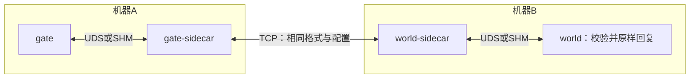

# 本机SHM优化对完整链路的收益：gate / sidecar / TCP / world

本机通信快了多少，不能直接当作完整链路快了多少。端到端收益取决于本机段占总耗时的比例，以及TCP、sidecar和world是否已经成为吞吐瓶颈。本基准让两端本机段分别使用UDS、SHM/eventfd和SHM/busy，中间始终使用真正的TCP连接，并由gate记录完整RPC的吞吐、RTT和流量。

## 1. 拓扑是三种角色、四个进程

两个机器各需要一个sidecar实例，实际为四个进程：



请求路径：gate→本机段→gate-sidecar→TCP→world-sidecar→本机段→world。回复沿原路径返回，最终gate收到一次回复才计为一次完成RPC。中间的多次转发不额外计为RPC。

`bench_chain`同一个可执行文件以不同角色启动：`gate`、`gate-sidecar`、`world-sidecar`、`world`。world只做校验和echo，不包含真实游戏/业务逻辑。

## 2. 延迟收益：由本机段占比决定

对低负载、近似串行的单次请求响应，设：

- `L`：两端本机段在完整往返中耗费的时间之和。
- `N`：中间TCP往返、代理处理、world业务处理等其他耗时。
- `s`：本机段的耗时加速倍数，即新本机耗时为`L/s`。

在其他耗时不变、没有显著排队变化的近似条件下：

```text
原RTT = L + N
新RTT = L/s + N
本机段占比 f = L/(L+N)
端到端加速倍数 = 1 / ((1-f) + f/s)
RTT降低比例 = f * (1 - 1/s)
```

例如本机段加速10倍：

| 本机段占原RTT比例 | RTT降低 | 串行RPC/s理论提升 |
|---|---:|---:|
| 10% | 9% | 9.9% |
| 30% | 27% | 37.0% |
| 50% | 45% | 81.8% |
| 80% | 72% | 257.1% |

这是耗时分解的条件性计算，不是实测承诺，也不能对任意RTT分位数机械应用。两端本机段各11µs、其他耗时54µs时，原RTT为76µs；若两端各降到1µs，RTT成为56µs，降低26.3%，串行RPC/s约提高35.7%。本机段的11倍加速，没有变成端到端11倍加速。

如果TCP往返本身是1ms，削减20µs本机耗时的端到端收益就很有限；如果网络只有几十µs、world处理也很轻，本机调度和通知的收益就更容易体现。

## 3. 饱和吞吐：由最慢的服务阶段决定

多个请求在途时，CPU处理、数据转发、网络带宽和窗口/批次等待都会限制吞吐。可用下面的上界模型理解：

```text
RPC/s ≤ min(
    gate与两个sidecar、world各自的处理能力,
    TCP请求方向有效字节能力 / 每请求帧字节数,
    TCP回复方向有效字节能力 / 每回复帧字节数,
    在途窗口与平均响应时间所允许的能力
)
```

TCP全双工的两个方向应分别计算：若每方向都能承载B字节/s、每请求和回复都是W字节，理想带宽上界为`B/W`，不是无条件使用`B/(2W)`。只有B被定义为双向合计能力时，才对应`B/(2W)`。

Little定律联系的是平均在途量、平均响应时间和吞吐。不能用P50的倒数估算随机batch吞吐；本程序发送整批后等待全批返回，也不是收到一个回复就补一个请求的持续滑动窗口，因此不能把最大batch当成始终保持的在途量。

本机段可能是原瓶颈。SHM降低sidecar的收发成本后，RPC/s可以提高到TCP或world的新上限。若原本TCP带宽已满，本机加速通常不能继续提高带宽上限，但仍可能减少部分等待和CPU占用。

真实排队存在反馈：局部加速会改变TCP的数据到达、合并、流控和排队，busy也改变CPU使用方式。实际链路不能保证N严格不变，因此最终仍需直接比较端到端结果。

## 4. 程序如何保持可比较性

三个模式为：

| `--mode` | 两端本机段 | sidecar TCP段 |
|---|---|---|
| `uds` | 非阻塞Unix stream，有界缓冲 | 非阻塞TCP |
| `shm-eventfd` | 当前生产SHM连接及按需eventfd通知 | 同一TCP实现 |
| `shm-busy` | 当前生产SHM连接，忙轮询读环 | 同一TCP实现，持续检查可读写 |

SHM使用现有`ShmServer`/`ShmAsyncClient`/`EventLoop`。UDS和TCP使用本基准的有界stream适配器，帧探测与SHM codec共享同一格式。结果包含这两种本机实现的实际差异，不能解读成所有UDS实现或仅某条系统调用的理论优劣。

TCP始终启用`TCP_NODELAY`，默认不手动设置TCP缓冲，保留内核自动调优；`--tcp-buffer`可显式设置，三个模式必须保持一致。程序记录实际初始TCP/UDS缓冲大小，不修改sysctl或网络配置。

busy sidecar把TCP可读写作为每轮数据任务：使用栈上的单fd `poll(...,0)`，不把TCP接收推迟到默认256轮的普通控制fd检查。此poll仍是系统调用。SHM本机段的通知减少，不意味着完整链路没有系统调用。其他控制fd仍遵循当前EventLoop策略，不提供严格实时处理上界。

### 帧与转发

TCP和本机段使用相同长度的帧：

```text
[magic/版本/模式标志：4字节][payload长度：4字节][序号：8字节][payload：P字节]
```

整数使用网络字节序。16字节帧头的模式标志使远端能够拒绝本机段模式不匹配的测试；两个机器必须使用相同`--mode`。不传递C++对象或进程内指针到TCP。

转发接收区返回借用视图，仅在当前消息回调内有效；`Send`在返回前把帧复制到目标有界缓冲/共享环。SHM codec的`std::any`只承载视图指针，当前GCC/libstdc++采用内联存储；不会逐消息构造大型拥有型payload对象。

发送/接收区一次性分配为8MiB，并在初始化时触页；无逐消息缓冲扩容或日志。RX只有在尾部空间耗尽时才移动残留不完整帧，TX使用连续有界队列，清空后复位，仅尾部不足时压缩残留数据，支持短读、短写和`EAGAIN`。

gate在途payload上限2MiB、batch上限256；应用帧头还会增加少量字节，数据队列保留充分余量。默认使用随机batch，可设`--batch-min 1 --batch-max 1`观察串行RTT。本程序没有混合消息尺寸，每个场景固定P。

## 5. 指标定义

| JSON字段 | 定义 |
|---|---|
| `rpc_s` | gate完成的请求＋回复对数 / 实际测量时间 |
| `p50_ns/p99_ns/p999_ns` | gate的Send前到回包解码后、业务内容验证前的采样RTT |
| `payload_mib_s` | `RPC/s × P / 1024²`，单向有效payload |
| `duplex_payload_mib_s` | `RPC/s × 2P / 1024²`，请求＋回复有效payload |
| `duplex_tcp_framed_mib_s` | `RPC/s × 2(P+16) / 1024²`，请求＋回复TCP应用帧 |
| `tcp_tx_bytes/tcp_rx_bytes` | 单个sidecar整个进程生命周期的socket字节计数，包含预热 |

默认展示的“流量MiB/s”是**请求加回复的有效payload合计**。含帧头字段是TCP应用字节，不包含TCP/IP/以太网头、ACK和重传，不是网卡线速。两个sidecar看到的是同一TCP连接，不能把双方TX+RX再相加当成网络实际流量。

gate测RTT使用自己的单调时钟，不需要双机时钟同步。默认按时间预热，然后重置随机batch序列；配对模式使用相同种子。所有请求检查序号/内容边界，约1/64做完整内容检查。直方图为固定数组，桶上界约1.56%分辨率；保留样本数，短测的P99.9不能作为生产SLA。

## 6. 构建与本机验证

```sh
cmake -S . -B build -DCMAKE_BUILD_TYPE=Release
cmake --build build --target bench_chain test_chain_wire test_chain_stream -j4
./build/test_chain_wire
./build/test_chain_stream
```

依赖与现有SHM库相同：Linux、C++17和pthread。新增代码没有try/catch/throw，使用错误码和有界/nothrow缓冲；帧辅助测试用禁用异常的编译选项构建。完整程序沿用现有库的实现，不能声称整个仓库已支持禁用异常。

本机完整四进程验证与对照：

```sh
python3 bench/compare_chain.py ./build/bench_chain /tmp/chain-loopback \
    --cpus 1 3 5 7 --seconds 5 --rounds 3
python3 bench/analyze_chain.py /tmp/chain-loopback --output /tmp/chain-loopback/analysis
```

默认16B、4KiB、64KiB、1MiB，每尺寸使用随机1–8和随机1–64，按2MiB在途payload缩小上限并去除重复范围，共7个场景×3模式×3轮=63次测量。可使用`--full`覆盖既有15个尺寸，或`--sizes`选择尺寸。`--smoke --full --messages 257`按固定完成量运行84个配置的正确性冒烟；不用于性能汇总。

这是**一台机器上四个独立进程与TCP回环**，可验证实际转发、协议、关闭及测量方法，不能称为真实跨机性能。这里选择的CPU仅是示例，应选择四个不同物理核心，避免抢占其他长测CPU。

## 7. 双机部署：用户自行部署，脚本只启动本机两个进程

在两台机器上构建同一版本。先运行机器B的world侧，再运行机器A的gate侧。举例假定机器B可达IPv4为`10.0.0.20`，TCP端口19001，两端每个本机对使用CPU1/3。

机器B：

```sh
./bench/start_chain_world.sh --binary ./build/bench_chain \
    --mode uds --tcp-address 0.0.0.0 --tcp-port 19001 \
    --app-cpu 1 --sidecar-cpu 3 --output /tmp/chain/world-uds-r1
```

看到`READY world pair`后，机器A：

```sh
./bench/start_chain_gate.sh --binary ./build/bench_chain \
    --mode uds --tcp-address 10.0.0.20 --tcp-port 19001 \
    --app-cpu 1 --sidecar-cpu 3 --bytes 4096 \
    --batch-min 1 --batch-max 8 --seed 1001 --round 1 \
    --warmup 2 --seconds 30 --stride 1 \
    --output /tmp/chain/gate-uds-r1
```

gate测量完成后关闭连接，关闭沿原链路传播，四个进程正常退出，world侧启动脚本也结束。下一次运行需要重新启动world侧。脚本不执行SSH、复制文件、修改防火墙或远端部署。

依次换成`shm-eventfd`和`shm-busy`，每次两个机器都设置相同mode，使用新的输出目录；同一轮保持相同bytes/batch范围/seed/TCP配置。至少3轮，轮换模式执行顺序，例如UDS→eventfd→busy、eventfd→busy→UDS、busy→UDS→eventfd。每轮seed可以不同，但轮内三个模式必须相同。

若只比较UDS和一种SHM模式，分析器也支持。`--messages N`可用于固定数量功能验证，正常性能测量默认按`--seconds`结束；`--timeout`控制gate无有效进展时的停止。所有子进程由启动脚本持有，Ctrl+C仅终止该脚本启动的进程。

默认socket路径位于每次启动的私有临时目录；也可以通过`--local`指定本机路径。gate和world不需要使用相同路径。显式路径的所有权与复用由部署者安排，不应让无关服务共享同一路径。

busy模式会让两端四个事件循环持续占用CPU，即使等待消息。CPU资源成本和跨机网络延迟应一起考虑。此程序不附带TLS、压缩、真实world工作负载或自动重连。

## 8. 汇总部署结果

gate侧每次运行生成`sample.json`、`gate.jsonl`、`gate-sidecar.jsonl`、命令、`run.json`和退出状态。world侧保存world/world-sidecar日志，便于核对返回、TCP字节和资源回收。

把不同mode/round的gate目录放到同一结果根目录下，或作为多个输入参数：

```sh
python3 bench/analyze_chain.py \
    /tmp/chain/gate-uds-r1 /tmp/chain/gate-eventfd-r1 /tmp/chain/gate-busy-r1 \
    /tmp/chain/gate-uds-r2 /tmp/chain/gate-eventfd-r2 /tmp/chain/gate-busy-r2 \
    /tmp/chain/gate-uds-r3 /tmp/chain/gate-eventfd-r3 /tmp/chain/gate-busy-r3 \
    --output /tmp/chain/analysis
```

输出`comparison.md`和`summary.json`，包含RPC/s、RTT、双向有效payload MiB/s、含帧头TCP MiB/s及逐轮配对提升百分比。负提升保留。不同场景分别分析，不混合计算一个“全链路通用提升比例”。

分析器检查配对种子、随机前缀、gate二进制指纹、主机/拓扑/测试配置和重复身份，拒绝输入失败运行。部署者仍需确认TCP确实跨机器、远端使用相同版本及TCP配置、没有更换网络条件；程序不根据某个IP地址自动宣称它就是物理跨机。

## 9. 当前本机验证结果与限制

本次仓库验证使用一台机器的TCP回环，报告见[四进程TCP回环验证报告](results/2026-11-24_sidecar_chain_loopback/README.md)。真实跨机RPC/s/RTT/MiB/s需要使用双机部署脚本采集，不能把回环数字直接代入跨机网络。

本机段占比变化、TCP带宽/RTT、sidecar CPU瓶颈和world业务耗时，会决定最终收益。即使某个本机测试显示十倍加速，也只有端到端测量才能回答当前部署究竟提升多少。


## Protobuf 直接编码版本

构建 `cmake --build build --target bench_chain_protobuf test_chain_protobuf -j`。
跨机脚本通过 `--binary ./build/bench_chain_protobuf` 选用该版本，部署仍由用户执行。
本机全量命令：

```bash
python3 bench/compare_chain.py ./build/bench_chain_protobuf bench/results/protobuf_chain --full --rounds 3 --seconds 5
python3 bench/analyze_chain.py bench/results/protobuf_chain --output bench/results/protobuf_chain_analysis
```

15种长度是实际Protobuf序列化长度，依次为16、128、256、512、1024、2048、3072、4096、8192、16384、32768、65536、131072、524288、1048576字节。
消息为 `optional fixed64 sequence` 与 `bytes payload`；序列号0也保留字段，大小不随序号变化。
序列化长度包含Protobuf字段开销，不包含额外16B链路帧头。例如16B消息含5B业务payload，128B含117B。没有补齐到256B。

Gate与world执行真实Protobuf序列化/解析，sidecar透明转发序列化帧。
发送端每次调用一次`ByteSizeLong`后立即执行`SerializeWithCachedSizesToArray`，期间不得修改消息。
SHM预留共享环写窗口，编码器直接写入该窗口；本测试每条连接将直接编码门槛设为0。
生产默认门槛仍为256B，`SetDirectEncodeMinimumBytes`由连接所属线程在空闲状态、首次发送前调用。
UDS同样直接编码到最终发送队列，避免引入额外中间序列化缓冲使对比失真。
Protobuf本身仍将业务bytes从消息对象复制到编码目的地；接收`ParseFromArray`也复制到复用的消息对象，不是业务数据零拷贝。

启动时读取/proc/self/maps，缓存共享memfd映射地址范围；每次编码检查目的地址并累计计数，不逐帧访问procfs或打印日志。
SHM端点要求所有序列化目的地址都在共享区，sidecar要求所有转发目的地址都在共享区；任何回退到缓冲区均判失败。
解析计数必须等于收包数、sidecar解析计数必须为0；复用payload地址变化也判失败。
这些计数/地址检查在三个模式中都启用，其少量成本包含在结果内。
报告`duplex_protobuf_mib_s`是双向Protobuf消息流量，`duplex_payload_mib_s`是扣除Protobuf字段开销的业务payload流量；`duplex_tcp_framed_mib_s`包含16B应用帧头但不包含TCP/IP开销。

本轮完整结果：[Protobuf直接编码15种长度对比](results/2026-11-24_protobuf_chain_loopback/README.md)。
