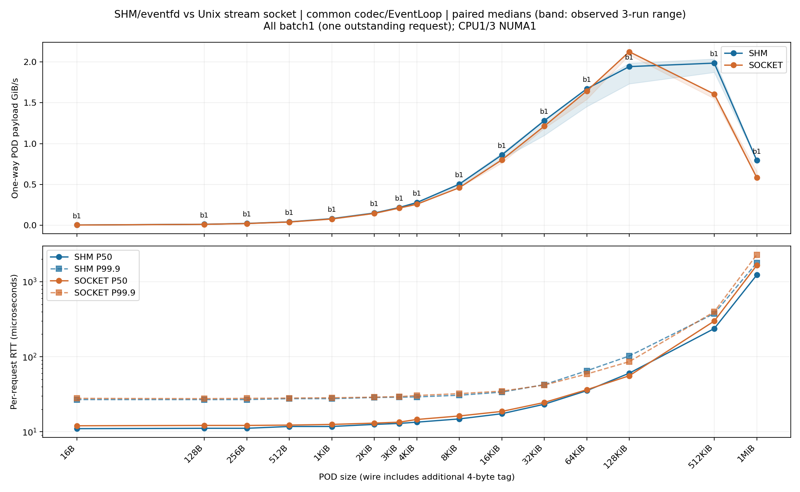

# Batch1：SHM/eventfd vs Unix stream socket（2026-11-23）

同样15个消息尺寸全部设为batch1：每次只发送一个请求，收到响应后再发送下一条。3轮交错A/B，共90次正式测量，逐请求全量记录RTT。全部正常完成并通过已覆盖的内容/序号和资源清理检查。

## 方法

- 与扩展尺寸报告使用完全相同的O2/NDEBUG benchmark二进制、SimplePodCodec、EventLoop、POD及固定内存直方图；仅改变运行参数。
- CPU1服务端、CPU3客户端，NUMA1；原CPU2/4七天长测保持运行。
- 每配置每种传输预热1秒、测量10秒，共3轮；A/B交错，第二轮尺寸反向。每进程只注册本尺寸一种POD。
- 消息体含8B序号，线格式另加4B tag；KiB按1024B。
- 全部请求都计时，时间从SendCmd前到响应回调入口，包含双方codec及事件循环。吞吐倒数是整体每RPC周期，仍不能替代直接记录的RTT分位数。
- 吞吐和RTT分位数分别取三轮中位数；提升按每轮SHM/Socket配对比值计算后取中位数。正值是SHM更快，负值是SHM更慢。

## 结果

| 消息体 | SHM RPC/s | Socket RPC/s | SHM吞吐提升 | SHM P50 µs | Socket P50 µs | SHM P99.9 µs | Socket P99.9 µs |
|---|---:|---:|---:|---:|---:|---:|---:|
| 16B | 89,325 | 82,216 | +8.9% | 11.01 | 12.03 | 26.88 | 27.90 |
| 128B | 88,574 | 80,886 | +9.5% | 11.14 | 12.16 | 26.88 | 27.65 |
| 256B | 88,278 | 80,524 | +9.8% | 11.14 | 12.16 | 26.88 | 27.90 |
| 512B | 83,676 | 80,194 | +4.3% | 11.78 | 12.29 | 27.65 | 28.16 |
| 1KiB | 83,359 | 78,639 | +5.3% | 11.78 | 12.54 | 27.65 | 28.42 |
| 2KiB | 77,858 | 75,199 | +3.5% | 12.54 | 13.06 | 28.67 | 28.93 |
| 3KiB | 75,401 | 73,076 | +3.5% | 12.93 | 13.44 | 28.93 | 29.44 |
| 4KiB | 72,574 | 67,083 | +7.9% | 13.44 | 14.59 | 29.18 | 30.46 |
| 8KiB | 65,801 | 60,158 | +8.7% | 14.85 | 16.26 | 30.72 | 32.26 |
| 16KiB | 56,343 | 52,393 | +7.5% | 17.41 | 18.69 | 33.79 | 34.82 |
| 32KiB | 41,962 | 39,761 | +5.1% | 23.30 | 24.58 | 42.50 | 41.98 |
| 64KiB | 27,389 | 26,945 | +1.6% | 35.33 | 36.35 | 65.02 | 58.88 |
| 128KiB | 15,922 | 17,416 | -8.6% | 60.42 | 55.81 | 102.40 | 86.02 |
| 512KiB | 4,068 | 3,290 | +23.5% | 237.57 | 299.01 | 376.83 | 397.31 |
| 1MiB | 813 | 596 | +36.4% | 1228.80 | 1654.78 | 1785.86 | 2293.76 |

## 判断

本轮batch1中，16B～32KiB的吞吐中位差异多为约3%～10%，明显小于先前batch64/256结果；64KiB约+1.6%，128KiB约-8.6%（Socket更快）；512KiB和1MiB分别约+23.5%和+36.4%。不能把批量测试的21%～100%直接套到串行请求。

32KiB和64KiB第三轮的吞吐排名反转，几%的差异不足以声称稳定优势。64KiB虽然吞吐中位数略高，其P99/P99.9却比Socket高；128KiB的P50和尾部也更高。因此吞吐和尾延迟分别解读。未做归因消融，不把负值或排名波动直接归为RingBuf缺陷。

## 三轮范围与曲线



阴影为三轮观测范围，不是置信区间。payload GiB/s按请求消息体计单向载荷，不含tag；请求+响应的总载荷是其2倍。RTT图为P50及P99.9桶上界，微秒范围分辨率约1.56%。

| 尺寸 | SHM 三轮RPC/s范围 | Socket 三轮RPC/s范围 |
|---|---:|---:|
| 32KiB | 36,049～42,352 | 38,882～39,930 |
| 64KiB | 23,811～27,448 | 25,267～26,993 |
| 128KiB | 14,196～16,266 | 17,084～17,487 |
| 512KiB | 3,836～4,173 | 3,176～3,293 |
| 1MiB | 811～813 | 596～677 |

## 限制与复现

同机AF_UNIX/SOCK_STREAM，不是TCP跨机器；Socket是基准专用适配器，保持当前接收块/派发后发送策略。内核Socket发送/接收缓冲均约416KiB，SHM每方向环8MiB，结果包含容量、缓存及实现策略差异。未锁频、未排除宿主机噪声，closed-loop不含发送前上游排队，没有coordinated-omission修正或业务SLA承诺。

使用30次串行冒烟确认所有尺寸路径；运行参数变化未改benchmark二进制，该二进制在上一轮已通过覆盖全部尺寸的ASan/UBSan冒烟。原始逐进程JSONL、命令、samples/summary、源码及二进制指纹和长测起止状态全部保留。

```sh
python3 bench/compare_socket.py /tmp/shm-size-matrix/bench_acceptance /tmp/shm-batch1-results --batch1 --server-cpu 1 --client-cpu 3
python3 bench/analyze_socket_comparison.py /tmp/shm-batch1-results
python3 bench/plot_socket_comparison.py /tmp/shm-batch1-results
```

`--batch1`自动选择扩展15尺寸、单类型codec和全量RTT采样。生产核心未修改，七天长测未中断。
