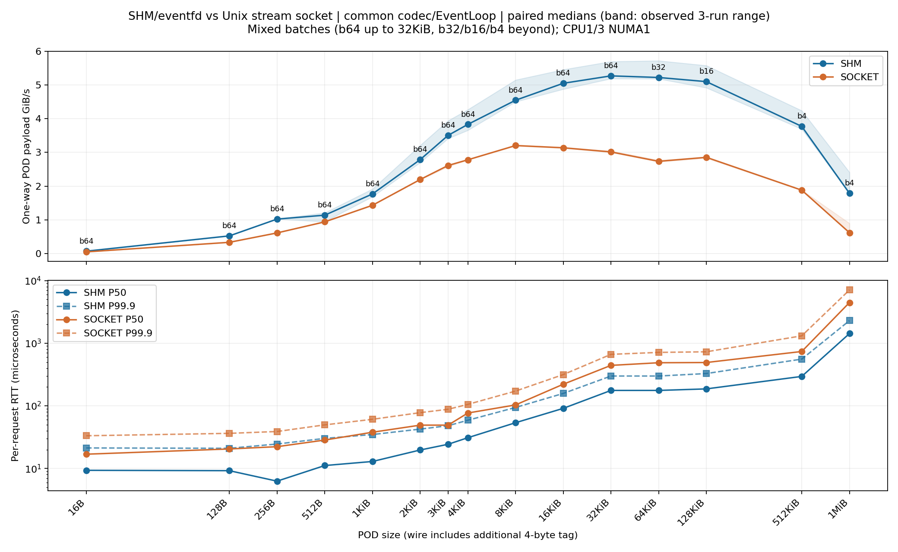

# 扩展尺寸：SHM/eventfd vs Unix stream socket（2026-11-23）

已补齐128B、256B、512B、1/2/3/8/16/32/64/128/512KiB，共12个新增尺寸；加上16B、4KiB、1MiB锚点，覆盖15个尺寸、18个配置。3轮交错A/B，共108次正式测量，全部正常完成并通过序号、内容边界/抽样完整内容与资源清理检查。

## 环境与口径

- 当前生产核心来自HEAD cb0be16；本轮未修改include下的核心实现。
- 7天长测正在CPU2/4运行；本轮改用另一物理socket/NUMA1的CPU1/3，长测未暂停。背景负载存在，不能与旧CPU2/4报告拼接绝对值，因此重新测量全部锚点。
- 两端真实进程，共同SimplePodCodec和EventLoop，Socket为AF_UNIX/SOCK_STREAM基准适配器，SHM保持eventfd通知。
- 每次预热1秒、测量10秒，3轮交错，第二轮尺寸反向。Release -O2 -DNDEBUG。
- 每个矩阵进程只注册本尺寸一种POD，避免扩充类型数量造成查找成本随注册顺序增长。消息体包括8字节序号，线上另有4字节tag。字节尺寸按KiB=1024解释。
- 至32KiB使用batch64；64KiB用32、128KiB用16、512KiB用4，新大尺寸在途消息体约2MiB。1MiB锚点保留batch1/4；16B保留batch1/64/256。跨尺寸曲线批次并非全部相同。
- 吞吐是完成请求/响应对的RPC/s；RTT逐请求从SendCmd前到响应回调入口，包含编解码和事件循环，不用吞吐倒数替代。

## 完整结果

吞吐和分位数分别取三轮中位数；倍率先按同配置同轮配对，再取中位数。吞吐提升列为 `median((SHM_RPC/s_i / Socket_RPC/s_i - 1) × 100%)`，不是RTT降低百分比。RTT直方图报告桶上界，分辨率约1.56%。

| 消息体 | batch | SHM RPC/s | Socket RPC/s | 配对吞吐倍率 | SHM吞吐提升 | SHM P50 µs | Socket P50 µs | SHM P99.9 µs | Socket P99.9 µs |
|---|---:|---:|---:|---:|---:|---:|---:|---:|---:|
| 16B | 1 | 88,586 | 81,471 | 1.09× | +8.8% | 11.14 | 12.03 | 25.60 | 27.39 |
| 16B | 64 | 4,741,106 | 3,335,460 | 1.42× | +41.6% | 9.34 | 16.90 | 21.25 | 33.28 |
| 16B | 256 | 11,160,345 | 6,280,025 | 1.78× | +77.9% | 10.11 | 32.00 | 28.67 | 55.81 |
| 128B | 64 | 4,397,515 | 2,797,913 | 1.57× | +57.2% | 9.22 | 20.48 | 20.99 | 36.35 |
| 256B | 64 | 4,289,368 | 2,568,453 | 1.67× | +67.0% | 6.27 | 22.27 | 24.58 | 38.91 |
| 512B | 64 | 2,387,349 | 1,971,803 | 1.21× | +21.1% | 11.14 | 28.42 | 30.21 | 49.66 |
| 1KiB | 64 | 1,853,616 | 1,501,247 | 1.23× | +23.5% | 12.93 | 37.89 | 34.82 | 60.93 |
| 2KiB | 64 | 1,460,786 | 1,151,545 | 1.27× | +27.3% | 19.71 | 49.15 | 42.50 | 77.82 |
| 3KiB | 64 | 1,225,108 | 913,221 | 1.34× | +34.2% | 24.32 | 49.15 | 48.13 | 88.06 |
| 4KiB | 64 | 1,004,520 | 729,195 | 1.38× | +37.9% | 30.98 | 76.80 | 58.88 | 105.47 |
| 8KiB | 64 | 596,137 | 419,959 | 1.42× | +42.3% | 53.76 | 103.42 | 94.21 | 172.03 |
| 16KiB | 64 | 331,009 | 205,623 | 1.60× | +60.3% | 91.14 | 221.18 | 157.70 | 315.39 |
| 32KiB | 64 | 172,710 | 98,775 | 1.76× | +75.5% | 176.13 | 442.37 | 299.01 | 663.55 |
| 64KiB | 32 | 85,568 | 44,826 | 1.92× | +91.9% | 176.13 | 487.42 | 299.01 | 712.70 |
| 128KiB | 16 | 41,779 | 23,386 | 1.79× | +78.6% | 186.37 | 491.52 | 327.68 | 729.09 |
| 512KiB | 4 | 7,725 | 3,850 | 2.00× | +100.3% | 294.91 | 737.28 | 557.06 | 1310.72 |
| 1MiB | 1 | 811 | 601 | 1.35× | +35.2% | 1228.80 | 1654.78 | 1638.40 | 2293.76 |
| 1MiB | 4 | 1,830 | 634 | 2.88× | +188.3% | 1425.41 | 4456.45 | 2293.76 | 7077.89 |

## 尺寸曲线



图中16B选择batch64、1MiB选择batch4；b数字标注批次。上图按每秒请求消息体换算单向GiB/s（请求+回复总载荷为2倍，不含tag）。阴影是三轮观测范围，不是置信区间；下图为逐请求P50和P99.9。

观察到128B/256B等点吞吐较稳定，512B及部分中大消息的SHM吞吐范围较宽；不能仅凭一条连接后的中位曲线认定尺寸边界造成固定退化。

三轮SHM吞吐范围示例：

| 尺寸/batch | 最低 RPC/s | 最高 RPC/s |
|---|---:|---:|
| 512B/64 | 1,988,659 | 2,538,260 |
| 1KiB/64 | 1,768,756 | 2,010,039 |
| 2KiB/64 | 1,415,598 | 1,683,786 |
| 4KiB/64 | 958,787 | 1,119,781 |
| 1MiB/4 | 1,827 | 2,469 |

128B编码长度132B走暂存缓冲，256B编码长度260B触发当前直接写ring的256B阈值；路径本身不同，不能假设尺寸变化应严格单调。本轮没有做阈值消融，不把某个性能跳变的全部贡献归因于该阈值。

## 限制

Socket仍是整批/当前接收块合并配置。本轮没有复测此前16B batch256的每64条子批合并诊断，不能将本表的batch256倍率推广到所有Socket发送策略；原诊断报告仍保留。Socket发送/接收缓冲实际均为425984B，SHM每方向环8MiB；结果含该环境容量及收发缓存策略差异。

测试为closed-loop合成echo，不含发送前上游排队、没有coordinated-omission修正或业务SLA承诺。1MiB等低速场景尾部分位数样本较少；样本数、最大RTT、三轮吞吐范围均保存在summary.json。

## 验证与复现

扩展模式ASan/UBSan+leak冒烟36次测量通过；旧默认三类型模式的7个SHM场景也通过，验证旧启动/验收命令仍兼容。生产核心和现有7天测试进程未改动。

```sh
cmake -S . -B /tmp/shm-size-matrix -DCMAKE_BUILD_TYPE=Release "-DCMAKE_CXX_FLAGS_RELEASE=-O2 -DNDEBUG"
cmake --build /tmp/shm-size-matrix --target bench_acceptance -j4
python3 bench/compare_socket.py /tmp/shm-size-matrix/bench_acceptance /tmp/shm-size-results --expanded --server-cpu 1 --client-cpu 3
python3 bench/analyze_socket_comparison.py /tmp/shm-size-results
python3 bench/plot_socket_comparison.py /tmp/shm-size-results
```

目录包含逐进程JSONL、命令、samples.json、summary.json、分位数表、PNG、sanitizer/兼容冒烟、环境、编译日志、源码/二进制指纹和长测起止状态。

百分比列为完成测量后的分析更新；`sources.sha256`保留测量时版本，`analysis_sources.sha256`记录当前分析脚本，原始`samples.json`未改动。
