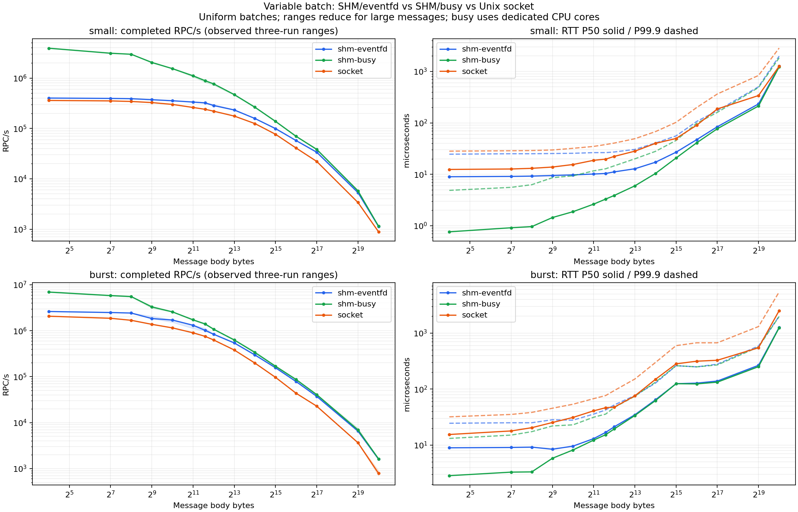

# 随机batch全尺寸SHM vs Unix socket（2026-11-24）

15个消息尺寸 × small/burst两组随机范围 × SHM/eventfd、SHM/busy、Unix stream socket × 3轮交错，共270次正式测量全部通过；另有90项ASan/UBSan全矩阵冒烟通过。测量阶段累计完成 **1,195,079,347 RPC**。

## 结论

本轮各场景SHM/eventfd相对Socket配对吞吐提升 **11.3%–103.7%**；SHM/busy提升 **28.9%–983.7%**。这是不同尺寸/随机范围下的结果范围，不是可统一套用的生产提升百分比。

- 16B随机1–8：Socket约35.9万、eventfd约40.1万、busy约391.3万RPC/s；busy相对Socket约10.84倍，P50从12.42降至0.76µs。
- 16B随机1–64：Socket约207.3万、eventfd约262.4万、busy约695.1万RPC/s；busy相对Socket约3.35倍。批量增大使每RPC吞吐提高，同时busy P50从0.76升到2.85µs，不能把吞吐提升等同于延迟降低。
- 4KiB随机1–8：eventfd提升29.8%，busy提升248.6%，busy P50为3.87µs；随机1–64则分别提升33.6%、71.6%，busy P50为19.46µs。
- 1MiB随机1–2和1–4：busy相对eventfd的额外吞吐中位提升分别仅约0.90%、1.10%，不足以支持为大消息专门付出持续自旋CPU成本的结论。
- busy并非每个场景都降低尾延迟：16KiB随机1–64的P99.9略高于eventfd，32KiB随机1–64的P50/P99.9中位数与eventfd相同。表中均保留实际值。

小消息、小批次更能体现省去等待/唤醒的收益。大量消息聚合或大块数据传输时，应结合吞吐、尾延迟和CPU成本选择模式。本轮没有新增需要修复的通信实现缺陷证据。

## 方法和公平性

- 同一Release二进制，实际编译参数 `-O3 -DNDEBUG`、GCC11.2；同一种SimplePodCodec/生产EventLoop/校验框架，每进程只注册本尺寸一种类型。
- CPU1服务端、CPU3客户端，NUMA1，不同物理核心。CPU2/4七天长测继续运行；起止状态保留，未暂停或终止。
- 每配置预热1秒/测量5秒，3轮模式次序轮换，第二轮尺寸次序反向；每模式在每配置的三个执行位置各出现一次。
- small通常均匀随机1–8，burst通常均匀随机1–64；64KiB burst上限32、128KiB上限16，512KiB/1MiB上限4；最后两个尺寸small上限2。每批等待全部回复后发送下一随机批次。
- 预热结束重置PRNG，同一配置/轮次三种传输使用相同种子；全部90个配对组的正式前256批哈希相同。每次运行全部覆盖了对应范围内的每个batch值；sum(batch×count)与完成RPC数一致。
- ≤32KiB观测平均batch：small为4.487–4.507，burst为32.317–32.600。按时间停止，快模式处理更长的随机序列前缀，实际分布差异可查全量计数。
- 新增随机/统计逻辑每批一个PRNG步骤、固定数组计数；发送热路径没有新增动态分配或逐消息随机生成/日志。常用2的幂范围以掩码映射；非2的幂取模。辅助代码通过禁用异常的构建，新增代码未引入try/catch/throw。
- RTT从SendCmd前至回复回调入口，≤4KiB散列约1/64采样，8–32KiB约1/16，≥64KiB全量计时。吞吐和分位数各取三轮中位数，提升按逐轮配对比值中位数计算。

## 吞吐

| 消息体 / 随机batch | Socket RPC/s | SHM eventfd RPC/s | eventfd提升 | SHM busy RPC/s | busy提升 |
|---|---:|---:|---:|---:|---:|
| 16B / 1–8 | 359,213 | 400,578 | +11.3% | 3,912,569 | +983.7% |
| 16B / 1–64 | 2,072,619 | 2,624,196 | +26.6% | 6,951,146 | +235.4% |
| 128B / 1–8 | 352,001 | 394,136 | +12.3% | 3,110,138 | +792.3% |
| 128B / 1–64 | 1,866,264 | 2,492,369 | +33.5% | 5,833,436 | +212.8% |
| 256B / 1–8 | 342,844 | 389,037 | +13.4% | 2,966,557 | +765.9% |
| 256B / 1–64 | 1,687,978 | 2,428,773 | +44.1% | 5,549,514 | +228.4% |
| 512B / 1–8 | 325,964 | 371,654 | +14.0% | 2,042,409 | +526.6% |
| 512B / 1–64 | 1,378,984 | 1,843,055 | +33.9% | 3,297,532 | +139.6% |
| 1024B / 1–8 | 299,700 | 354,218 | +18.6% | 1,536,469 | +414.5% |
| 1024B / 1–64 | 1,153,581 | 1,710,270 | +48.3% | 2,575,661 | +123.3% |
| 2048B / 1–8 | 260,557 | 333,830 | +28.2% | 1,106,559 | +324.9% |
| 2048B / 1–64 | 902,256 | 1,316,606 | +46.8% | 1,728,859 | +92.8% |
| 3072B / 1–8 | 239,714 | 321,813 | +33.8% | 883,807 | +269.4% |
| 3072B / 1–64 | 754,527 | 1,021,630 | +35.4% | 1,406,376 | +86.4% |
| 4096B / 1–8 | 219,834 | 284,766 | +29.8% | 766,380 | +248.6% |
| 4096B / 1–64 | 629,323 | 838,454 | +33.6% | 1,079,872 | +71.6% |
| 8192B / 1–8 | 175,869 | 232,391 | +32.5% | 469,415 | +166.9% |
| 8192B / 1–64 | 380,778 | 542,992 | +42.8% | 628,200 | +65.4% |
| 16384B / 1–8 | 124,869 | 157,419 | +26.1% | 264,052 | +110.9% |
| 16384B / 1–64 | 197,759 | 297,888 | +50.6% | 336,287 | +70.0% |
| 32768B / 1–8 | 76,552 | 99,320 | +28.9% | 137,856 | +81.0% |
| 32768B / 1–64 | 96,685 | 156,217 | +61.1% | 169,045 | +74.8% |
| 65536B / 1–8 | 40,773 | 57,355 | +40.6% | 69,581 | +70.7% |
| 65536B / 1–32 | 43,517 | 78,223 | +81.1% | 86,537 | +100.3% |
| 131072B / 1–8 | 22,129 | 33,749 | +53.2% | 38,345 | +74.0% |
| 131072B / 1–16 | 22,801 | 37,251 | +63.4% | 40,671 | +78.4% |
| 524288B / 1–2 | 3,388 | 5,322 | +57.7% | 5,776 | +69.0% |
| 524288B / 1–4 | 3,648 | 6,533 | +79.1% | 6,932 | +90.0% |
| 1048576B / 1–2 | 886 | 1,130 | +27.5% | 1,142 | +28.9% |
| 1048576B / 1–4 | 784 | 1,597 | +103.7% | 1,625 | +107.3% |

## RTT

P50/P99.9均为µs；P99也保存在summary.json。

| 消息体 / 随机batch | Socket P50/P99.9 µs | SHM eventfd P50/P99.9 µs | SHM busy P50/P99.9 µs |
|---|---:|---:|---:|
| 16B / 1–8 | 12.42/28.16 | 8.96/24.58 | 0.76/4.86 |
| 16B / 1–64 | 15.49/32.00 | 8.96/24.58 | 2.85/13.18 |
| 128B / 1–8 | 12.67/28.67 | 9.09/25.09 | 0.91/5.57 |
| 128B / 1–64 | 17.92/35.33 | 9.09/25.09 | 3.30/15.10 |
| 256B / 1–8 | 13.06/28.93 | 9.22/25.09 | 0.96/6.27 |
| 256B / 1–64 | 20.48/38.40 | 9.22/25.09 | 3.33/17.41 |
| 512B / 1–8 | 13.82/29.70 | 9.47/25.34 | 1.44/8.58 |
| 512B / 1–64 | 25.34/45.57 | 8.45/28.42 | 5.82/22.02 |
| 1024B / 1–8 | 15.49/32.00 | 9.73/25.60 | 1.87/9.34 |
| 1024B / 1–64 | 31.23/53.76 | 9.60/27.90 | 8.19/23.04 |
| 2048B / 1–8 | 18.69/34.82 | 10.11/26.37 | 2.62/11.65 |
| 2048B / 1–64 | 40.96/67.58 | 13.06/35.84 | 12.29/31.49 |
| 3072B / 1–8 | 19.71/37.89 | 10.37/26.37 | 3.30/12.80 |
| 3072B / 1–64 | 46.59/76.80 | 16.90/42.50 | 15.36/35.84 |
| 4096B / 1–8 | 22.27/40.45 | 11.14/27.14 | 3.87/14.59 |
| 4096B / 1–64 | 47.62/94.21 | 21.25/52.22 | 19.46/47.10 |
| 8192B / 1–8 | 28.16/49.15 | 12.80/30.46 | 5.95/19.97 |
| 8192B / 1–64 | 75.78/151.55 | 34.82/76.80 | 33.79/74.75 |
| 16384B / 1–8 | 39.94/67.58 | 17.15/40.45 | 10.37/27.90 |
| 16384B / 1–64 | 149.50/299.01 | 64.51/128.00 | 62.46/133.12 |
| 32768B / 1–8 | 49.66/102.40 | 26.88/55.81 | 20.74/45.57 |
| 32768B / 1–64 | 282.62/598.02 | 124.93/262.14 | 124.93/262.14 |
| 65536B / 1–8 | 90.11/198.66 | 47.10/106.50 | 40.96/98.30 |
| 65536B / 1–32 | 315.39/671.74 | 128.00/249.86 | 123.90/249.86 |
| 131072B / 1–8 | 186.37/364.54 | 83.97/172.03 | 76.80/159.74 |
| 131072B / 1–16 | 327.68/671.74 | 139.26/278.53 | 133.12/270.34 |
| 524288B / 1–2 | 339.97/835.58 | 233.47/503.81 | 212.99/487.42 |
| 524288B / 1–4 | 548.86/1310.72 | 266.24/589.82 | 251.90/565.25 |
| 1048576B / 1–2 | 1261.57/2850.82 | 1261.57/1982.46 | 1228.80/1835.01 |
| 1048576B / 1–4 | 2523.14/5439.49 | 1261.57/1998.85 | 1245.18/1982.46 |

## 曲线、范围和验证



吞吐阴影为三轮观测范围，不是置信区间。三轮范围、最少RTT样本数和各模式平均batch保存于measurement/summary.json。1MiB随机1–4的Socket吞吐为699–899 RPC/s，波动显著；未选择最好或最差的一轮代替配对中位结果。

270次正式运行和90次sanitizer冒烟均通过已覆盖的类型、序号、载荷边界/抽样完整内容、发送失败及退出fd/mapping清理检查。每次正常关闭连接，server opened==closed；这不构成持续负载下UDS/定时器处理时限的证明。RandomBatch辅助测试覆盖固定期望序列、范围、可复现性、阶段重置、非2的幂及固定范围、确定性的分布健全性检查。

## 限制与复现

均匀随机批量只是无生产trace时的合成负载：请求加权的RTT偏向大批，closed-loop没有业务空闲、外部到达率或上游排队，也没有coordinated-omission修正。不要称为任意生产环境的延迟/吞吐保证。

Socket是同机AF_UNIX/SOCK_STREAM基准专用适配器，保持接收块/派发后合并发送，内核收发缓冲约416KiB；SHM每方向8MiB。结果包含实现和缓冲差异，不能代表所有Socket实现。busy双方各持续占用一个逻辑CPU，控制fd仍按默认256轮检查；若排空/业务回调长期不返回，控制事件仍可能延后。

未锁频、未排除宿主机噪声；直方图约1.56%桶上界。最少RTT样本数为3495，大消息5秒短测的P99.9仅对应少量尾部观测，不能据此承诺生产SLA。之前固定batch/O2或裸RingBuf结果不与本轮直接拼接。

measurement/保留270次原始命令/日志、samples.json、配对summary和独立表；sanitizer_smoke/保留90次冒烟。sources.sha256、compile_flags.txt、binary.sha256及起止长测状态可复查。source_commit.txt标识分支基线，测量时含未提交修改；measured_changes.patch保存通信/基准修改及新增源码，以实际源码/二进制指纹为准。

```sh
python3 bench/compare_random_batch.py /tmp/shm-busy-poll/bench_acceptance /tmp/shm-random-ab --server-cpu 1 --client-cpu 3
python3 bench/analyze_random_batch.py /tmp/shm-random-ab
python3 bench/plot_random_batch.py /tmp/shm-random-ab
```

参数和实现契约见[随机batch方法](../../random_batch.md)。
