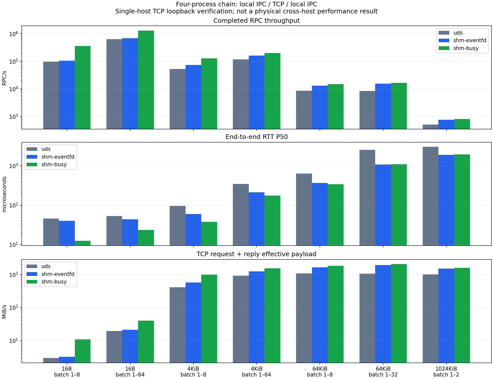

# 四进程本机段/TCP/本机段：TCP回环验证（2026-11-24）

本报告为**单机四进程、TCP回环**，不是物理跨机性能。实际路径为gate→UDS或SHM→gate-sidecar→TCP→world-sidecar→UDS或SHM→world，world原路回复。真实双机结果需要部署后采集。

7个场景（16B、4KiB、64KiB两组随机范围，1MiB一组）×3个本机模式×3轮，共63次正式测量全部通过。每次预热1秒、测量5秒，轮换模式位置、第二轮反向场景；同一组使用相同种子，正式前64批哈希一致。

## 主要结果

16B随机1–8：UDS约95,882、SHM/eventfd约106,171、SHM/busy约355,545 RPC/s；busy相对UDS配对吞吐提升270.8%，P50从46.08降至12.42µs。完整链路加速约3.71倍，不能直接套用此前两进程本机测试的倍数；两份测试的帧格式、codec及拓扑不同，也不能反推精确网络耗时占比。

1MiB随机1–2：UDS约508、eventfd约752、busy约801 RPC/s；busy相对UDS提升57.5%。busy的P50约1949.70µs，略高于eventfd的1884.16µs，吞吐和RTT没有同步改善。64KiB随机1–32也出现busy P50略高于eventfd的情况。保留实际结果，不把吞吐提升当作所有分位延迟改善。

## 指标

流量为请求＋回复有效payload的MiB/s（1MiB=1024²B）。另列TCP应用帧量，包含16B应用帧头，不包含TCP/IP/以太网、ACK或重传。侧车原始字节计数包含预热，正式流量由完整RPC数计算。RTT由gate单调时钟记录，无跨机时钟同步需求。

| 场景 | 本机段模式 | RPC/s | P50/P99.9 RTT µs | 双向有效载荷 MiB/s | 含应用帧头TCP MiB/s | 相对UDS吞吐提升 |
|---|---|---:|---:|---:|---:|---:|
| 16B / 1–8 | uds | 95,882 | 46.08/118.78 | 2.926 | 5.852 | — |
| 16B / 1–8 | shm-eventfd | 106,171 | 39.94/78.85 | 3.240 | 6.480 | +11.6% |
| 16B / 1–8 | shm-busy | 355,545 | 12.42/24.83 | 10.850 | 21.701 | +270.8% |
| 16B / 1–64 | uds | 630,918 | 52.74/115.71 | 19.254 | 38.508 | — |
| 16B / 1–64 | shm-eventfd | 693,529 | 43.52/103.42 | 21.165 | 42.330 | +10.0% |
| 16B / 1–64 | shm-busy | 1,305,799 | 23.55/39.42 | 39.850 | 79.700 | +107.7% |
| 4096B / 1–8 | uds | 52,577 | 96.26/169.98 | 410.755 | 412.359 | — |
| 4096B / 1–8 | shm-eventfd | 73,575 | 59.90/143.36 | 574.807 | 577.053 | +40.5% |
| 4096B / 1–8 | shm-busy | 127,442 | 37.89/59.39 | 995.638 | 999.527 | +143.3% |
| 4096B / 1–64 | uds | 118,075 | 344.06/598.02 | 922.458 | 926.061 | — |
| 4096B / 1–64 | shm-eventfd | 159,084 | 210.94/356.35 | 1242.843 | 1247.698 | +34.2% |
| 4096B / 1–64 | shm-busy | 197,789 | 176.13/282.62 | 1545.228 | 1551.264 | +66.8% |
| 65536B / 1–8 | uds | 8,578 | 630.78/1523.71 | 1072.285 | 1072.546 | — |
| 65536B / 1–8 | shm-eventfd | 13,147 | 368.64/663.55 | 1643.314 | 1643.715 | +53.3% |
| 65536B / 1–8 | shm-busy | 14,665 | 339.97/557.06 | 1833.139 | 1833.586 | +71.5% |
| 65536B / 1–32 | uds | 8,432 | 2523.14/4915.20 | 1053.972 | 1054.229 | — |
| 65536B / 1–32 | shm-eventfd | 15,545 | 1081.34/2228.22 | 1943.089 | 1943.563 | +84.4% |
| 65536B / 1–32 | shm-busy | 16,538 | 1097.73/1851.39 | 2067.206 | 2067.711 | +96.0% |
| 1048576B / 1–2 | uds | 508 | 3014.66/5570.56 | 1016.392 | 1016.408 | — |
| 1048576B / 1–2 | shm-eventfd | 752 | 1884.16/3309.57 | 1503.466 | 1503.489 | +47.4% |
| 1048576B / 1–2 | shm-busy | 801 | 1949.70/2654.21 | 1602.209 | 1602.233 | +57.5% |

## 测量环境和范围

- 同一Release `-O3 -DNDEBUG`二进制，CPU1 gate、CPU3 gate-sidecar、CPU5 world-sidecar、CPU7 world，四个不同物理核心、NUMA1。七天长测CPU2/4持续运行，起止状态保留。
- TCP始终使用127.0.0.1、TCP_NODELAY，保留默认缓冲自动调优；本机UDS为AF_UNIX/SOCK_STREAM。端点帧采用网络字节序，模式/序号/长度/内容验证一致。
- SHM走生产连接及WireCodec，UDS/TCP走有界stream适配器。缓冲初始化预触页，转发用借用视图及同步复制，避免逐消息拥有型对象分配。busy sidecar每轮检查TCP，不延迟到256轮控制fd轮询。
- busy占用四个逻辑CPU，UDS/eventfd空闲时可阻塞。未锁频、未排除宿主机噪声，没有业务world工作、TLS或混合消息尺寸。
- closed-loop整批等待；RTT请求加权，不能从P50倒数推导RPC/s。直方图桶约1.56%上界，短测尾分位不构成SLA。

## 验证和文件

- Wire单元测试：网络字节序、分片、不完整帧、长度/模式边界、错误类型及借用codec视图；以禁用异常选项构建。
- Stream单元测试：小内核发送缓冲下的短写/EAGAIN、队列满、发送回绕、12个1MiB消息连续传递以及半帧EOF协议错误。
- 最终ASan/UBSan：15尺寸、28随机范围配置、3模式，共84个四进程固定257RPC配置通过，见sanitizer_final。sanitizer_smoke为预触页修订前的验证，不用于最终性能结果。
- 双机成对启动脚本在本机验证通过，见host_script_validation；模式不匹配负例被拒绝，未产生成功sample，见mode_mismatch_negative（失败是预期结果）。
- 所有63次正式运行检查gate完整回复、四个角色帧数一致、两端TCP读写字节精确相等、fd恢复到基线。没有新增通信缺陷证据；不证明任意持续负载下控制事件的实时处理上界。

measurement包含逐进程命令/JSONL/sample.json，analysis包含中位汇总、三轮范围和图。sources.sha256/compile_flags.txt/source_commit.txt标识测量源码基线及工作区指纹；排序与绘图的最终分析源码单独记录于analysis_sources.sha256。流测试辅助程序在测量后补充了socketpair早期失败时的RAII保护，并重新通过Release及ASan/UBSan测试；其最终指纹见final_test_sources.sha256。测量程序未改变。新增代码和测量时工作区修改尚未提交。

双机部署、完整参数、流量定义和收益模型见[链路测试文档](../../chain.md)。本报告不能当作部署在两台物理机器上的性能保证。
