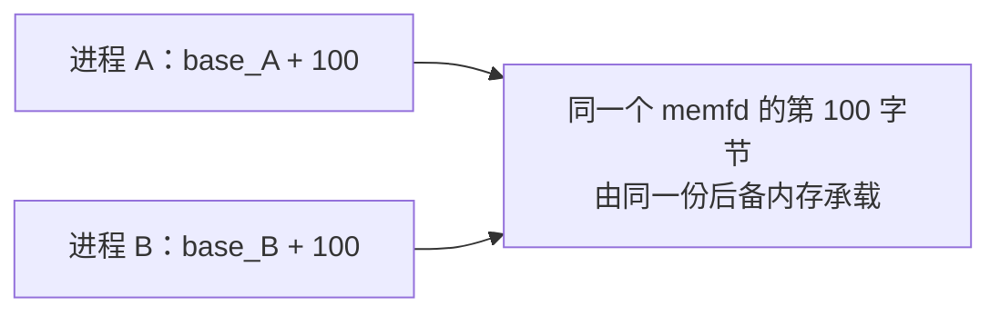

# memfd_create 与 mmap：两个进程如何共享同一份内存

假设进程 A 要把消息交给进程 B。使用 socket 时，A 把消息交给内核，B 再从内核读取。我们希望消息留在一块内存里，A 写进去，B 就能直接读取，减少消息数据的中转。

但 A 用 `malloc` 分配内存，再把指针发给 B，并不能做到这一点：每个进程都有自己的虚拟地址空间，A 的指针只在 A 的地址空间中有意义。即使 B 恰好有一个数值相同的地址，也不代表那里是 A 的数据。

所以，共享内存需要解决两个问题：**让两个进程引用同一份数据，再让它们各自获得访问这份数据的地址。** Linux 的 `memfd_create` 和 `mmap` 分别承担这两件事。下面沿着一条消息从 A 到 B 的过程解释它们如何配合。

## 1. 数据不能只属于 A，该放在哪里？

首先，A 调用 `memfd_create`，请内核创建一个内存文件，并得到一个文件描述符 fd。

这里的“文件”可以理解为**由内核管理、按字节偏移访问的一份数据**。它没有普通文件路径，也不需要在磁盘上创建文件，却能像文件一样设置长度、传递引用和建立映射。选择这种对象，是因为它可以被多个进程共同引用，不局限于 A 的私有内存。

fd 是 A 访问这个对象的句柄，不是数据地址。此时我们只是有了一个可共享的对象，还没有可用的缓冲区：新建 memfd 的长度为 0。

因此，A 接着调用 `ftruncate(fd, size)`，确定它的长度。例如设为 8 MiB，就得到了一个逻辑上有 8 MiB 的共享数据空间。这一步规定能使用多少字节；物理内存通常在实际访问时按需分配，并不是设置长度时就全部分配好。

到这里，**共享数据有了归属和大小，但 A 还不能通过指针访问它。**

## 2. A 怎样把这个对象当作内存来读写？

A 对这个 fd 调用 `mmap`，要求把文件内容映射到自己的虚拟地址空间，并选择可读写权限和 `MAP_SHARED`。

`mmap` 返回一个基址，记为 `base_A`。映射从文件偏移 0 开始时，访问 `base_A + 100`，就是访问这个内存文件的第 100 个字节。

这一步不是把文件复制到 A 的私有缓冲区，而是建立“**A 的这段虚拟地址对应文件的这段内容**”的关系。访问时，内核和硬件通过页表把虚拟地址连接到承载文件内容的内存页；首次访问可能需要内核分配或找到相应页，之后正常读写就是普通的内存访问。

为什么要指定 `MAP_SHARED`？因为我们希望写入修改的是共同的数据。若使用 `MAP_PRIVATE`，写入会通过写时复制形成私有修改，无法作为这里的双向可写共享区。

现在 A 已经可以通过指针写数据了。接下来缺的是：**B 如何找到同一个对象？**

## 3. B 怎样取得同一份数据，而不是另建一份？

B 不能再调用一次同名的 `memfd_create`：名称只是调试标识，两次创建得到的是两个独立对象。B 也不能直接使用 A 发来的 fd 数字，因为 fd 是各自进程内部的编号。

本仓库通过 Unix domain socket 的 `SCM_RIGHTS` 传递 fd。内核把 A 的文件引用交给 B，并在 B 的 fd 表中分配一个编号。例如 A 的 fd 是 7，B 收到的可能是 12，但它们引用的是**同一个 memfd 对象**，数据没有因此复制一份。

B 再用收到的 fd 调用 `mmap`，同样映射文件偏移 0，并使用 `MAP_SHARED`，得到自己的基址 `base_B`。它不需要、通常也不会等于 `base_A`。



于是，A 写入 `base_A + 100`，B 从 `base_B + 100` 读取，访问的是同一份数据。**共享成立的关键是同一对象、对应的文件偏移和 `MAP_SHARED`，不是两端地址相同。**

这也解释了为什么共享区里不能直接保存某个进程的裸指针。如果要引用共享区中的其他位置，应保存偏移，让每个进程用自己的基址还原地址。

到此，共享内存已经建立。socket 在这里负责把共享对象的引用交给另一端；映射建立后，消息字节可以通过共享区直接读写。

## 4. 能读到同一份数据，是否就能可靠地传消息？

还不能。假设 A 正在写一条消息，B 此时读取，可能读到尚未写完的内容。共享内存只解决“数据在哪里、如何访问”，还需要协议解决“什么时候可以读、什么时候可以覆盖”。

本仓库把共享区组织成环形缓冲区：数据区存放消息，头部记录写入位置和读取位置。每个方向只有一个生产者和一个消费者，按下面的顺序协作：

1. A 确认有空闲空间，写完消息，再以 `release` 发布新的写入位置。
2. B 以 `acquire` 观察写入位置，确认数据已发布后读取消息。
3. B 读完后以 `release` 发布读取位置；A 以 `acquire` 观察它，确认这段空间可以重新使用。

这些原子操作让“消息内容”和“位置更新”保持正确的先后关系。共享页上的更新通过 CPU 缓存一致性机制被另一端观察，不需要为每条消息调用 `msync`；但缓存一致性本身不能替代发布协议。

如果 B 正在睡眠，还需要通知它起来检查共享区。本仓库可以用 eventfd 唤醒，也可以在 busy 模式下轮询。**通知告诉 B 去检查，写入位置告诉 B 哪些数据已经可读。**

## 5. 本仓库如何把这些步骤组合成一条连接？

一条连接需要请求和回复两个方向，因此使用两个独立的 memfd：一个用于 client → server，另一个用于 server → client。每一端创建自己的写环，并把它的 fd 交给对端作为读环。

对每个方向，建连过程都是：

```text
创建 memfd
    → 设置“头部 + 数据区”的长度
    → 创建者建立共享映射并初始化环
    → 通过 Unix domain socket 传递 fd
    → 接收者建立共享映射
    → 双方按位置发布协议读写同一个环
```

仓库还在设置长度后封印文件尺寸，禁止扩大或缩小；接收者在映射前检查尺寸与封印。这样做是为了让双方始终按相同容量访问共享区，避免运行中长度变化破坏映射。封印的是大小，消息数据仍然可以写入。初始化由创建者完成，接收者使用已有状态，不再把环清零。

环形缓冲区还有一个实际问题：消息可能从数据区尾部跨回开头，逻辑上完整，地址上却分成两段。仓库为此尝试**镜像映射**：先预留连续的虚拟地址范围，再把同一个文件的数据区紧邻映射两次。

```text
文件内容：       [ 头部 ][ 数据区              ]
进程的地址视图： [ 头部 ][ 数据区第一圈        ][ 数据区第二圈        ]
                         两圈对应同一段文件内容
```

从第一圈尾部继续访问，地址会进入第二圈，而第二圈开头对应的仍是文件数据区开头。因此，跨环尾的消息可以用一段连续地址访问，无需先拼接尾部和头部。

第二圈只是同一份数据的另一个地址视图，不增加环容量，也不复制数据。镜像映射是建立共享之后的访问优化；即使某一端退化为普通映射，双方仍然共享同一份数据。

## 6. 通信结束后，这份内存由谁释放？

fd 和映射是对共享对象的两种引用。`close(fd)` 释放文件描述符，`munmap` 解除当前进程的地址映射。成功映射后，即使关闭 fd，已有映射仍然可以使用，因为映射本身保留了对象引用。

一端退出或解除映射，不会撤销另一端仍在使用的映射。等所有 fd、映射及其他内核引用都释放后，内核才能回收这个 memfd 及其数据，不需要额外删除一个文件路径。socket 断开也不会自动解除共享映射，库的连接清理负责释放这些资源。

回看整个过程：**`memfd_create` 提供可共同引用的数据对象，`ftruncate` 确定大小，fd 传递让另一进程取得同一对象，`mmap(MAP_SHARED)` 让双方各自获得直接访问它的地址，环的同步协议让这些访问组成可靠的消息通信。**

相关实现：[common.hpp](../include/shm_ipc/common.hpp) 中的 `CreateMemfd` 和 `MmapRegion`、[ring_channel.hpp](../include/shm_ipc/ring_channel.hpp) 中的建连流程、[ringbuf.hpp](../include/shm_ipc/ringbuf.hpp) 中的位置发布协议。fd 传递机制另见 [SCM_RIGHTS 文档](scm_rights.md)。
