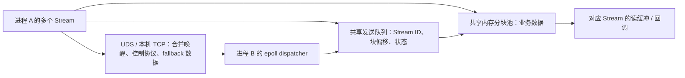

# 字节跳动 Shmipc 实现分析

调研日期：2026-11-26。对象是字节跳动 CloudWeGo 的 [shmipc-go](https://github.com/cloudwego/shmipc-go)。分析固定在提交 [`55c241eea321071278d1ee7f7c46292d23e50a5b`](https://github.com/cloudwego/shmipc-go/tree/55c241eea321071278d1ee7f7c46292d23e50a5b)，该提交日期为 2025-10-21；这是本次拉取时仓库 HEAD，并非声称项目此后没有其他分支或发布。

本报告依据公开源码静态阅读，没有执行该项目的测试、重新测量其性能，也没有验证字节内部生产部署。官方历史 benchmark 与本仓库结果不能直接比较。

## 公开资料

- [官方中文说明与历史 benchmark](https://github.com/cloudwego/shmipc-go/blob/55c241eea321071278d1ee7f7c46292d23e50a5b/README_CN.md)：项目来源、接口、性能定位。
- [共享队列实现](https://github.com/cloudwego/shmipc-go/blob/55c241eea321071278d1ee7f7c46292d23e50a5b/queue.go)：描述符队列及通知状态。
- [共享内存分块池](https://github.com/cloudwego/shmipc-go/blob/55c241eea321071278d1ee7f7c46292d23e50a5b/buffer_manager.go)与[Buffer 接口](https://github.com/cloudwego/shmipc-go/blob/55c241eea321071278d1ee7f7c46292d23e50a5b/buffer.go)：分配、借用和回收。
- [Session](https://github.com/cloudwego/shmipc-go/blob/55c241eea321071278d1ee7f7c46292d23e50a5b/session.go)、[Stream](https://github.com/cloudwego/shmipc-go/blob/55c241eea321071278d1ee7f7c46292d23e50a5b/stream.go)、[协议处理](https://github.com/cloudwego/shmipc-go/blob/55c241eea321071278d1ee7f7c46292d23e50a5b/protocol_manager.go)：收发路径、通知和 fallback。
- [直接编码示例](https://github.com/cloudwego/shmipc-go/blob/55c241eea321071278d1ee7f7c46292d23e50a5b/example/best_practice/idl/example.go)、[热升级示例](https://github.com/cloudwego/shmipc-go/blob/55c241eea321071278d1ee7f7c46292d23e50a5b/example/hot_restart_test/README.md)。
- [ROADMAP](https://github.com/cloudwego/shmipc-go/blob/55c241eea321071278d1ee7f7c46292d23e50a5b/ROADMAP.md)：规划资料，需要与实际源码分开。例如它仍列出 ARM 支持计划，但当前配置校验和队列布局已经包含 arm64 分支。

## 1. 核心架构：数据和调度信息分离

Shmipc 是面向多路逻辑流的 Go IPC 库，而不只是一个共享内存 ringbuffer。



反向通信使用另一条共享队列。两个方向的数据块从共享 bufferManager 分配，而不是分别沿一条连续字节环推进。

Session 对应一条底层 socket 和一对共享 IO 队列；Session 上可以复用多个 Stream。SessionManager 管理多个 Session 和 Stream 池，分散并发压力、处理重连与热升级。

这种设计的价值是：socket 数量和共享队列不必随逻辑请求数量线性增加，某个 Stream 的数据也可以单独交给业务处理。代价是增加块分配回收、Stream 查找、锁和 Go 调度成本。

## 2. 如何建立共享内存

根据 [config.go](https://github.com/cloudwego/shmipc-go/blob/55c241eea321071278d1ee7f7c46292d23e50a5b/config.go)和[协议初始化](https://github.com/cloudwego/shmipc-go/blob/55c241eea321071278d1ee7f7c46292d23e50a5b/protocol_initializer.go)，客户端创建共享内存，服务端映射。

| 模式 | 建立方式 | 底层连接约束 |
|---|---|---|
| 默认 `/dev/shm` 文件 | 创建、truncate、MAP_SHARED；发送路径让对端打开和映射 | UDS 或本机 TCP；两端须能访问同一共享文件 |
| memfd | memfd_create、ftruncate、MAP_SHARED；SCM_RIGHTS 传递 buffer 和 queue 两个 fd | 源码要求 Unix socket |

共享内存包含两类对象：存数据的 bufferManager，以及包含两个方向队列的 queueManager。它的 memfd 支持并不意味着通过跨机 TCP 也能共享物理内存；TCP 在这里可用作**同机进程的同步通道**。

协议有版本协商和共享内存确认。memfd 路径还包含“准备接收 fd”的确认，然后接收 ancillary data、解析 fd 并映射。

当前默认队列容量是 8192，每个队列元素为 12B；默认共享数据池为 32MiB。源码里个别旧注释的队列容量/元素大小不同，应以 `const.go` 和实际布局为准。

## 3. 数据块：不是连续字节环

每个数据块有 20B 头：

```text
capacity:u32 | size:u32 | start:u32 | next_offset:u32 | flags:u32
```

块之间通过共享内存中的**偏移**连接，不能传递本进程虚拟地址。Go 的 bufferSlice 对象只是进程内视图，包装共享块的数据和头部。

默认配置把共享池按约 8KiB、32KiB、128KiB 三种块规格分配，比例分别为 50%、30%、20%；实际 payload 容量扣除了块头。

分配尝试取能容纳所需数据的单块，失败后某些写接口可以拼接多块。各规格有共享空闲链表，通过 atomic/CAS 维护头尾和数量。归还时重置块并连接到空闲链表尾部；保留一个不被分配的尾部节点，处理队列边界。

这是显式内存池，不是让 Go GC 回收共享块。进程内包装对象另外通过 sync.Pool 复用。

优点是块可以按消费情况独立释放，方便多 Stream 管理。连续字节环则无需这套分配器，但它的空间通常按读位置顺序回收；两者解决的调度和生命周期问题不同。

这里的 CAS 空闲链表不能仅凭“用了原子操作”就判定设计完备。偏移复用、并发发布链表链接、最后节点规则都属于正确性分析内容。本次只确认其算法结构，没有对它做形式验证或故障注入。

## 4. IO 队列：传描述符，不传业务 payload

每个队列元素只有三个 u32：

```text
Stream ID | 根数据块在共享内存中的偏移 | Stream 状态
```

字段名 `seqID` 在该路径实际用作 Stream ID，不是每条业务消息的唯一序列号。

生产者先写元素，再通过原子操作发布 tail；消费者观察 tail 后读取元素，再推进 head。该次发布让此前已写好的业务块与元数据可以被对端读取。

`queue.put()` 使用**进程内 sync.Mutex**串行化多个本地生产者，不是全程无锁队列。消费者由 Session 对应的 dispatcher 路径收割。它面向“本端多生产者、对端单消费路径”；这个本地 mutex 也不能用来保护任意多个进程同时生产同一个队列。

queue_test.go 包含多生产者/单消费者测试，与该结构一致。

另外，queue 头总共只有 24B，head、tail、workingFlag 没有分离到独立缓存行；amd64 布局还有未自然对齐的 int64 地址，arm64 分支单独处理 8B 对齐。这与本仓库通过缓存行隔离游标、限定 SPSC 来降低一致性成本的选择不同。

## 5. 通知合并：有 fd，但不是每条消息一个唤醒

发送路径可以概括为：

```text
Reserve / WriteBytes
  → 更新共享块头和链接
  → Flush 把描述符放入共享队列
  → workingFlag 的 0→1 CAS 成功才发送 socket polling event
```

接收侧 epoll 收到 socket 事件后，批量 pop 描述符，定位 Stream 并交付数据。它持续收割到队列为空，再准备退出。

workingFlag=1 表示消费侧处于工作状态，或已经安排了一次唤醒。后续生产者无需重复通知。消费者结束时执行：

```text
workingFlag = 0
重新检查队列
  空：退出，等待下一次 socket 事件
  非空：workingFlag = 1，继续收割
```

重新检查解决两个关键交错：生产者在消费者撤销工作标志前发布数据、没有发通知时，消费者会看到非空队列继续处理；生产者在消费者退出后发布数据时，会取得 0→1 并发出通知。中间窗口可能产生冗余通知，不能因此省掉重新检查。

这里的“polling event”是**要求对端收割共享队列的协议事件名**，不是持续 busy polling。源码数据通知走 socket；socket 的 dispatcher 用 epoll。项目也没有在这条数据通知路径使用 eventfd。

`handlePolling` 每次收割后会 `runtime.Gosched()`，随后仍根据共享队列状态继续处理；这不是固定消息数的读取预算。异步业务 OnData 则通过 gopool 调度，可能增加调度开销，但也允许业务处理与 socket 事件路径分离。

对 batch1 来说，若每次请求/回复都让收割侧由空闲转为工作，双方仍会发生 socket 写入和唤醒。共享内存主要节约 payload 经过 socket 的复制成本，小消息不保证取得很大的 RTT 改善。

## 6. “零拷贝”的边界

| 路径 | 实际行为 |
|---|---|
| Reserve 后直接编码 | 可直接写进共享块，省去中间编码缓冲；编码器本身仍可能复制业务字段 |
| WriteBytes / WriteString | 把业务数据 copy 进共享块 |
| ReadBytes 在单个块内 | 返回共享内存借用切片，不复制该段 payload |
| ReadBytes 跨越多个块 | 分配连续结果缓冲，把各块内容拼接复制 |
| Stream 的 net.Conn Read/Write 兼容接口 | 走适配层的复制读写 |
| socket fallback | 重新组装 socket 数据，接收侧也有复制 |

因此，“不把大 payload 搬进内核 socket buffer”与“业务对象从产生到使用没有任何复制”不是同一个承诺。

示例 IDL 编码对整数使用 Reserve 后写入，对字符串和 byte slice 使用 WriteString/WriteBytes：它仍存在业务字段到共享内存的复制。

读取借用切片后，调用 ReleasePreviousRead 会使先前视图失效；过早释放可能导致其他写者复用该块。不释放则会占住共享池，降低可用空间。

Stream.ReleaseReadAndReuse 还会在满足条件时交换读写缓冲，让最后一个已消费的共享块用于后续写入，减少 ping-pong 的分配与归还操作。它复用的是块；业务层仍需正确决定回复内容，并不是自动零拷贝回显。

## 7. 默认大包路径与 fallback

这个区别对我们现有的 Protobuf 直接编码测试尤其重要。

`Reserve(size)` 需要返回一段连续空间。当现有块放不下，它会尝试申请能够容纳 size 的单个共享块。超过最大块容量时，不能靠多个块组成一段连续 slice，因而可能分配普通进程内缓冲。

默认最大块约 128KiB，所以“一次 Reserve(1MiB)，把整个 Protobuf 编进去”不等价于默认 SHM 快路径。可以调整 BufferSliceSizes，使单块容纳完整消息；也可以改变编码方式，分段写入，但后者需要处理跨块读写和可能发生的拼接复制。

某些 WriteBytes 路径可以把大数据拆入多个共享块；这与要求连续结果的 Reserve 路径不同。

共享池不足时，linkedBuffer.alloc 也会使用普通内存；Flush 检测到该缓冲不是全共享内存来源后，通过底层 socket 发送 fallback data。

一旦某个 Stream 写端进入 fallback 状态，后续发送持续走 socket，以免两条传输路径造成乱序。Session 同时会标记一段时间不健康，SessionManager 的池化路径会据健康状态处理后续借用。

不要把所有拥塞都归为“队列满就转 socket”：共享描述符队列满时，Flush 的当前实现最多进行 10 次、每次 10ms 的重试，然后返回错误；数据块不足触发的是另一条 fallback 路径。

Fallback 提供了空间不足时的继续传输能力，但会让尾延迟和吞吐发生模式切换。因此测量时应该同时报告 allocShmErrorCount、fallbackWriteCount、fallbackReadCount、queueFullErrorCount，而不是只输出一个总体 RPC/s。

## 8. 断线回收、重连与热升级

socket 除了传通知，还承担对端存活检测。EPOLLRDHUP/远端关闭进入 Session 关闭路径，通知 Stream 停止，通过 dispatcher 清理连接和 Stream。

queueManager 的关闭会 munmap；文件模式尝试删除路径，memfd 模式关闭 fd。bufferManager 在本进程全局表中按引用数管理，最后一个本地引用释放后才 munmap、删除文件或关闭 memfd。这个 refCount 不是跨进程的内核引用数。

memfd 的物理页最终能否释放，仍取决于所有进程是否都释放对应映射和 fd；一个进程退出不会让另一个进程的有效映射立刻消失。文件模式还要区分 unlink 与已有映射的生命周期。

SessionManager 检测 Session 关闭后会重建连接/Session，默认重试间隔为 60 秒。重连可以在同进程仍持有同名全局 bufferManager 的情况下复用该映射，但这不表示旧 Stream、旧队列及未完成业务 RPC 自动恢复。

热升级是显式 epoch 协议：客户端建立新 Session/池，把新业务切换过去，旧池暂时保留、等待旧侧排空和关闭。新 epoch 会影响共享内存命名。这是并存与排空策略，不能直接解释为新进程接管一条任意掉线的旧字节环继续运行。

有两个可直接从源码确认、需要与宣传区分的清理细节：

- bufferManager.unmap 注释写“spin 5s”，实际循环是 50 次、每次 sleep 100µs，即名义等待约 5ms 加调度时间，之后仍执行 munmap。持有借用视图的业务不能依赖这个等待保护长期使用。
- 部分 memfd 创建失败分支并不统一清理，例如 queue 的 memfd 创建成功后 Ftruncate 失败直接返回，该分支未见 close。这是静态代码观察，尚未通过故障注入复现资源泄漏。

## 9. 官方 benchmark 实际测了什么

来源：[bench_test.go](https://github.com/cloudwego/shmipc-go/blob/55c241eea321071278d1ee7f7c46292d23e50a5b/bench_test.go)。

它不是我们之前的跨进程 Protobuf 链路测试：客户端/服务端 Session 建在同一个 Go 测试进程内，用多个 goroutine 和 UDS 建连；共享内存通过 memfd 建立。RunParallel 的每个 worker 做顺序 ping-pong，不是随机 batch 的多请求在途模式。

消息是 JSON 编码的 byte slice。名字为 64B 的场景，实际编码长度为 100B；名字为 1MiB 的场景，实际编码长度为 1,398,116B，包含 JSON/base64 开销。b.SetBytes 使用请求与回复的编码长度之和，Go 输出 MB/s，不能当作本仓库的业务 payload MiB/s。RunParallel 的 ns/op 也是并行基准归一化的每操作耗时，不是单个 RPC 的 P50 RTT。

配置还特意调整为：

- 队列容量 65535。
- 共享池 256MiB，部分大场景为 512MiB。
- BufferSliceSizes 仅一个规格、占比 100%，单块大小就是该场景的 JSON 编码长度。

这解释了为什么大包 Reserve 能走单块共享内存，而默认三种分块不能直接代表该结果。

SHM 使用 Reserve、ReadBytes 和 ReleaseReadAndReuse；UDS 基准每轮还会分配读写缓冲，双方分配成本并不对称。JSON Encoder 自身也可能使用中间编码存储；因此不能只凭 Reserve 就认定这是完全没有编码复制的测试。

README 的历史数据中，64B 名义场景 SHM 为 7740ns/op，UDS 为 5523ns/op；4KiB 为 16574 对 31889ns/op；1MiB 为 1078216 对 2626436ns/op。这能说明官方展示的是“小包未必获益，大包更明显”的定位，但不能证明当前代码、默认配置、真实双进程或我们四进程链路会获得相同倍率。

## 10. 与本仓库的对应关系

| 维度 | 字节 shmipc-go，本次源码 | 本仓库当前 SHM |
|---|---|---|
| 数据组织 | 多规格共享块池，数据链表 | 每方向连续 SPSC 字节环 |
| 到达信息 | 独立描述符队列，Stream ID + 块偏移 | 读写游标 + 帧解码 |
| 并发模型 | 多本地生产者、锁串行发布，多个逻辑 Stream | owner EventLoop 线程收发，SPSC |
| 通知 | UDS/本机 TCP，workingFlag 合并唤醒 | eventfd 按需通知；另有 busy 模式 |
| 连续大消息 | 需合适分块，否则分段或 fallback | 镜像映射支持环尾连续窗口，仍受环容量限制 |
| 共享空间不足 | 部分路径转普通内存/socket，Stream 写端保持 fallback | 当前发送缓冲/队列及错误处理；不是该项目的 socket payload fallback |
| 读视图生命周期 | 借用共享块，显式 ReleasePreviousRead | Peek/CommitRead 或解码回调期间的借用视图 |
| 服务治理 | Session/Stream 池、指标、重连、epoch 热升级 | 当前以连接、事件循环和明确生命周期为主 |

本仓库在小量连接、单线程事件循环、可信本机对端这个范围内，已经选择了较短的数据路径。为了借鉴多 Stream 能力而替换成共享块池，会增加分配器、块链和跨块处理，未必适合现有需求。

最值得借鉴的是：把通知合并与防丢唤醒作为明确协议；让直接编码和借用视图的生命周期可验证；给快路径/退化路径分别计数；若以后确实需要热升级，再设计 epoch、旧连接排空和新连接切换。

本次源码不支持“字节用了更特殊的无 fd 通知，所以我们小消息提升小”的判断。两者通知结构都依赖共享状态来省掉重复唤醒；字节公开版本仍通过 socket/epoll 同步。持续 busy polling 是另外一种 CPU 换延迟的取舍，应独立对比。
